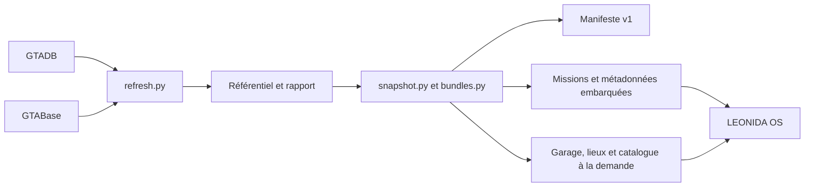

# LEONIDA Data Engine V0.21

## Rejouer le snapshot

Depuis la racine, avec Python 3.11 ou ultérieur et sa bibliothèque standard, exécuter les commandes suivantes.

```sh
python3 hub/snapshot.py --output /tmp/leonida-v1
python3 -m unittest discover -s hub/tests -v
```

Sans `--output`, la commande régénère les sorties dans le dépôt. Le rejeu lit uniquement les fiches normalisées et le rapport du dernier import. Deux copies du même commit produisent les mêmes octets, indépendamment de l'heure de reconstruction. Git versionne ensemble les entrées et les sorties. Pour exposer le résultat à d'autres lecteurs pendant sa génération, construire dans une nouvelle racine et distribuer cette racine après succès.



## Contrat v1

Le point d'entrée est `public/data/hub/manifest.json`, servi sous `data/hub/manifest.json`. Les chemins dans `bundles` sont relatifs à la racine du projet. Un consommateur accepte `schemaVersion: 1`, ignore les champs additionnels, vérifie la longueur et le SHA-256 des octets UTF-8 avant de décoder un nouveau fichier, et peut conserver son dernier jeu valide si la vérification échoue. Une modification incompatible de forme ou de sens exige une nouvelle version majeure.

| Champ | Interprétation |
| --- | --- |
| `snapshotAt` | Début de l'import source, avec fuseau. Le rejeu conserve cette valeur. |
| `sources` | État à l'import, licence et dernière collecte connue. GTADB fournit aussi sa révision Git et sa date. GTABase fournit la date de découverte du sitemap. |
| `records` | Nom du fichier sous `hub/records/`, nombre d'entrées, octets et SHA-256. L'index GTABase des missions est une table d'ordre distincte des entités. |
| `importReport` | Octets et SHA-256 de `hub/reports/latest.json`, qui détaille erreurs, couverture, changements, contradictions et déduplication. |
| `bundles` | Pour chaque module, format JSON, octets et SHA-256. |
| `missingRelationTargets` | Identifiants cités mais absents du référentiel. Les relations sans cible connue conservent leur URL dans les fiches. |

Chaque fiche comporte `id`, `type`, `name`, `fields`, `prov`, `rel`, `conf` et `cov`. Les types présents sont inventoriés par les fichiers `<source>-<type>.json`. Une relation ambiguë de type `located_candidates` peut conserver une liste de cibles candidates. Une relation indique son `kind`, sa cible `to` si connue et, selon son origine, l'URL ou la justification. `conflicts` conserve les valeurs divergentes avec leur provenance. Les liens `leonida` et les alias relient les fiches aux entités historiques.

Les identifiants sont opaques et persistants. Les lieux conservent `place:gtadb-L…`. Le moteur distingue désormais la Maibatsu Caddy (`gtabase:vehicles/caddy`) de la Caddy ’82 (`gtabase:vehicles/caddy-82`) grâce aux deux URL originales. Celebration Caddy pointe vers la ’82. Une ancienne sélection enregistrée sous la clé commune reste associée à la Caddy historique. Son intention précise est irrécupérable.

Pour les sources directes, `prov[].source` référence l'entrée du manifeste portant `upstreamOrigin` et `aggregator`. La provenance conserve l'URL, la licence et, si disponible, la date de collecte ou la révision. Plusieurs URL d'un même éditeur peuvent étayer une fiche. Elles comptent comme une seule origine pour un recoupement.

## Contenu et limites

- GTADB fournit 3 754 lieux, dont 3 663 avec position et 91 sans position. Les 42 références Vision restent disponibles à la demande.
- GTABase fournit 1 596 fiches après déduplication, dont 589 véhicules et 120 missions de type `mission`. Les types `stranger` et `activity` s'y ajoutent. L'import conserve 164 soluces structurées et 775 étapes. L'état historique de GTABase est partiel. Les 492 images Garage restent dans leurs planches existantes.
- L'app utilise les projections compactes définies par `src/lib/hub/model.ts`. Missions et métadonnées sont embarquées lors du build. Garage, lieux et catalogue sont des fichiers locaux à l'Artifact. Le manifeste est disponible aux autres consommateurs. Les politiques de progression et d'anti-spoiler continuent à s'appliquer dans LEONIDA OS. Le référentiel développeur contient des spoilers.
- L'Artifact limite les fichiers à 512 et bloque les requêtes vers des origines externes. Le snapshot intégré se met à jour au build. Aucune dépendance applicative supplémentaire.

## Acquisition et reprises

`python3 hub/refresh.py` utilise les adaptateurs et le cache incrémental existants. `--offline` sur cette commande rejoue l'extraction des sources brutes. Utiliser `snapshot.py` sur un clone neuf pour reconstruire sans ces sources. Un échec de collecte détecté avant normalisation laisse en place l'import précédent et écrit `hub/reports/last-attempt.json` avec l'heure de tentative, les sources obsolètes et la date du snapshot retenu. Une nouvelle URL GTABase indisponible reste signalée dans le rapport. Une URL auparavant utilisée qui disparaît empêche le remplacement et demande une revue. Une collecte complète réussie efface l'avis d'échec.

La collecte lit les alias applicatifs versionnés dans `hub/state/leonida-entities.json`. Après un changement des entités dans l’app, la commande explicite `node hub/export-leonida.mjs` renouvelle ce fichier pour revue.

La révision GTADB peut avancer indépendamment des tuiles de l'app. Le rapport expose `upToDate` pour comparer les révisions. La mise à jour des repères bruts et des tuiles relève du chantier carte.

### Sources facultatives

L'adaptateur Vice City lit l'endpoint public de démonstration des collections. Il conserve l'identifiant du fournisseur, le nom, la catégorie, la date de modification, le lien de la fiche et les origines citées. L'échantillon versionné dans `hub/samples/` contient cinq fiches sur 22, révision `4bfe64b8877f`. Les provenances citent PowerPyx et identifient Vice City comme agrégateur. Elles restent disponibles pour revue hors client. Le mode local accepte la réponse brute via `--input fichier.json`.

```sh
python3 hub/adapters/vice_city.py > /tmp/vice-city-collectibles.json
```

Crédit et conditions de l'API : [Vice City API](https://vice-city.app/developers). La carte MapGenie publique a répondu HTTP 403 pendant l'essai du 24 novembre 2026. L'accès aux couches de repères via Vice City exige un abonnement payant. Les données de ces couches restent hors de ce snapshot.

## Lecture du rapport de qualité

Le rejeu écrit aussi `hub/reports/snapshot-v1.json` sous la racine de destination. Ce rapport donne les effectifs par type, les empreintes des modules, les contradictions d'import et les anomalies de relations. L'instantané livré contient zéro cible absente et une anomalie de type : la relation de variante du Maverick vise News Maverick, que l'extracteur a classé comme article. Le lien brut est conservé pour réexamen de la fiche GTABase.

## Performances mesurées le 24 novembre 2026

Comparaison de deux exports Artifact locaux réalisés avec le même instantané RADAR et les mêmes dépendances. Base `9822856`, données v1 `de18a22`. Les changements suivants du moteur et de la documentation conservent les octets des bundles. Le manifeste de publication du build compte **471 → 472 fichiers** et **62 002 656 → 62 006 452 octets**. Il exclut sa propre liste locale des fichiers à publier. Le manifeste de données ajoute 3 825 octets. Les cinq bundles passent de 581 729 à 581 698 octets. Les missions synchrones occupent toujours 145 065 octets.

Chromium, fenêtre mobile 393 × 852, facteur de pixels 3, serveur local sans compression, nouveau contexte par parcours. Médianes de trois essais. Délai depuis le début de la navigation jusqu'à la première carte véhicule visible, au canevas MapLibre visible, ou au champ de saisie IA visible. Cela exclut toute réponse de modèle. Les mesures réseau portent sur les entrées Resource Timing à l'inactivité réseau, hors document HTML. La mémoire est le tas JavaScript utilisé à cet instant.

| Module | Ouverture ms avant → après | Requêtes avant → après | Octets avant → après | Tas JS Mo avant → après |
| --- | ---: | ---: | ---: | ---: |
| Garage | 3 233 → 2 623 | 17 → 26 | 3 473 136 → 5 087 697 | 17,5 → 13,3 |
| Carte | 5 588 → 5 357 | 17 → 17 | 4 334 382 → 4 334 384 | 13,5 → 13,4 |
| IA | 3 851 → 2 538 | 14 → 15 | 3 139 737 → 3 152 879 | 12,2 → 12,3 |

Les trois essais incluent la variabilité du chargement différé des planches du Garage et de la charge du poste partagé. Le nombre médian de ressources Hub sur le parcours Garage varie de 2 à 11. Pour la Carte et l'IA, il reste à zéro dans les deux builds. Ces essais ne permettent pas d'attribuer une accélération au moteur ni de conclure sur le confort d'un iPhone physique. Le découpage par chapitre ou par zone demanderait une modification du consommateur et un gain mesuré. La v1 livre cinq projections compatibles.

Pour reproduire la comparaison, servir les deux répertoires avec `node scripts/serve.mjs /chemin/out-artifact PORT` sur deux ports distincts, puis lancer :

```sh
CHROME_PATH=/usr/bin/chromium node hub/measure.mjs http://localhost:4481 http://localhost:4482
```

## Vérifications de livraison

- Python : 28 tests réussis. Rejeu sans cache brut, concordance octet pour octet avec les sorties Git, intégrité, identifiants, ambiguïtés et échec de collecte couverts.
- Dans une copie isolée : collecte GTADB en ligne, puis reconstruction depuis les fiches obtenues avec manifeste identique. Un second import GTADB en mode cache a validé la mise en attente des sorties avant remplacement. Le lot GTABase provient du référentiel versionné.
- TypeScript et builds standard et Artifact réussis. Les empreintes des trois bundles publics ont été vérifiées dans les deux exports. Les neuf tests V0.20.1 sur le build Artifact passent en simulation iPhone.
- Playwright sur le build standard : **538 tests distincts réussis après relances, 4 ignorés**. Unitaires, Chromium iPhone et iPad : 461 réussis, 3 ignorés. WebKit : 77 réussis, 1 ignoré sur plusieurs passages. Trois contrôles WebKit ont échoué avec Chromium exécuté en parallèle : stabilisation de la fiche IA, ouverture du Garage en moins de quatre secondes, et parcours continu V0.7.1 (délai de clic). Les deux premiers ont également échoué sur la base. Les trois ont réussi ensemble lors de la relance WebKit seule, avec les seuils du dépôt.
- L'émulation et le modèle Claude simulé couvrent les comportements applicatifs. La latence sur iPhone physique et la qualité du modèle réel restent à mesurer.
