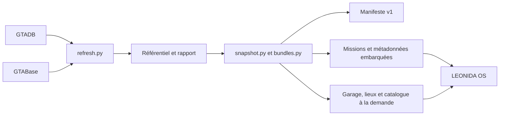

# LEONIDA Data Engine V0.21

## Rejouer le snapshot

Depuis la racine, avec Python 3.11 ou ultérieur et sa bibliothèque standard, exécuter les commandes suivantes.

```sh
python3 hub/snapshot.py --output /tmp/leonida-v1
python3 -m unittest discover -s hub/tests -v
```

Sans `--output`, la commande régénère les sorties dans le dépôt. Le rejeu lit uniquement les fiches normalisées et le rapport du dernier import. Deux copies du même commit produisent les mêmes octets, indépendamment de l'heure de reconstruction. Git versionne ensemble les entrées et les sorties. Pour exposer le résultat à d'autres lecteurs pendant sa génération, construire dans une nouvelle racine et distribuer cette racine après succès.



## Contrat v1

Le point d'entrée est `public/data/hub/manifest.json`, servi sous `data/hub/manifest.json`. Les chemins dans `bundles` sont relatifs à la racine du projet. Le manifeste et chaque description de projection portent `schemaVersion: 1`. Les cinq projections gardent la forme JSON attendue par la V0.20.2. Le pipeline vérifie l’inventaire exact, la version, les champs structurants, les identifiants uniques, les tailles et les SHA-256. Le build standard contrôle ensuite les trois fichiers publics dans `out/` et le build Artifact effectue le même contrôle dans `out-artifact/`. Les deux autres projections entrent dans le code compilé après le contrôle des sources. L’application sur iPhone utilise directement ses ressources locales. L’ouverture de l’app ne déclenche ni téléchargement du manifeste ni calcul de SHA-256. Une modification incompatible de forme ou de sens exige une nouvelle version majeure.

| Champ | Interprétation |
| --- | --- |
| `snapshotAt` | Début de l'import source, avec fuseau. Le rejeu conserve cette valeur. |
| `sources` | État à l'import, licence et dernière collecte connue. GTADB fournit aussi sa révision Git et sa date. GTABase fournit la date de découverte du sitemap. |
| `records` | Nom du fichier sous `hub/records/`, nombre d'entrées, octets et SHA-256. L'index GTABase des missions est une table d'ordre distincte des entités. |
| `importReport` | Octets et SHA-256 de `hub/reports/latest.json`, qui détaille erreurs, couverture, changements, contradictions et déduplication. |
| `bundles` | Pour chaque module, version de schéma, format JSON, octets et SHA-256. |
| `missingRelationTargets` | Identifiants cités mais absents du référentiel. Les relations sans cible connue conservent leur URL dans les fiches. |

Chaque fiche comporte `id`, `type`, `name`, `fields`, `prov`, `rel`, `conf` et `cov`. Les types présents sont inventoriés par les fichiers `<source>-<type>.json`. Une relation ambiguë de type `located_candidates` peut conserver une liste de cibles candidates. Une relation indique son `kind`, sa cible `to` si connue et, selon son origine, l'URL ou la justification. `conflicts` conserve les valeurs divergentes avec leur provenance. Les liens `leonida` et les alias relient les fiches aux entités historiques.

Les identifiants sont opaques et persistants. Les lieux conservent `place:gtadb-L…`. Le moteur distingue désormais la Maibatsu Caddy (`gtabase:vehicles/caddy`) de la Caddy ’82 (`gtabase:vehicles/caddy-82`) grâce aux deux URL originales. Celebration Caddy pointe vers la ’82. Une ancienne sélection enregistrée sous la clé commune reste associée à la Caddy historique. Son intention précise est irrécupérable.

Pour les sources directes, `prov[].source` référence l'entrée du manifeste portant `upstreamOrigin` et `aggregator`. La provenance conserve l'URL, la licence et, si disponible, la date de collecte ou la révision. Plusieurs URL d'un même éditeur peuvent étayer une fiche. Elles comptent comme une seule origine pour un recoupement.

## Contenu et limites

- GTADB fournit 3 754 lieux, dont 3 663 avec position et 91 sans position. Les 42 références Vision restent disponibles à la demande.
- GTABase fournit 1 596 fiches après déduplication, dont 589 véhicules et 120 missions de type `mission`. Les types `stranger` et `activity` s'y ajoutent. L'import conserve 164 soluces structurées et 775 étapes. L'état historique de GTABase est partiel. Les 492 images Garage restent dans leurs planches existantes.
- L'app utilise les projections compactes définies par `src/lib/hub/model.ts`. Missions et métadonnées sont embarquées lors du build. Garage, lieux et catalogue sont des fichiers locaux à l'Artifact. Le manifeste est disponible aux autres consommateurs. Les politiques de progression et d'anti-spoiler continuent à s'appliquer dans LEONIDA OS. Le référentiel développeur contient des spoilers.
- L'Artifact limite les fichiers à 512 et bloque les requêtes vers des origines externes. Le snapshot intégré se met à jour au build. Aucune dépendance applicative supplémentaire.

## Acquisition et reprises

`python3 hub/refresh.py` utilise les adaptateurs et le cache incrémental existants. `--offline` sur cette commande rejoue l'extraction des sources brutes. Utiliser `snapshot.py` sur un clone neuf pour reconstruire sans ces sources. Un échec de collecte détecté avant normalisation laisse en place l'import précédent et écrit `hub/reports/last-attempt.json` avec l'heure de tentative, les sources obsolètes et la date du snapshot retenu. Une page indisponible, une erreur de sitemap ou un budget de collecte incomplet empêchent la promotion de la tentative GTABase. Les fichiers cache restent utilisables pour reprendre. Les noms des cibles manquantes et les conflits de type bloquent également le rejeu du snapshot. Une URL auparavant utilisée qui disparaît empêche le remplacement et demande une revue. Une collecte complète réussie efface l'avis d'échec.

Avec un `lastmod`, une copie du cache reste fraîche tant que la révision concorde. Sans `lastmod`, sa durée de vie est de **7 jours depuis le dernier téléchargement réussi**. Une date absente, illisible, sans fuseau ou future entraîne une relecture. Une erreur laisse le contenu et sa date intactes et force une nouvelle tentative au prochain passage en ligne. `--force` impose la relecture même si une copie est fraîche. `--offline` prime sur `--force` et distingue une copie fraîche d’une copie expirée. Exemple de collecte bornée :

```sh
python3 hub/refresh.py --source gtabase --max 10 --force
python3 hub/verify_manifest.py
python3 hub/verify_manifest.py --export out-artifact
```

La collecte lit les alias applicatifs versionnés dans `hub/state/leonida-entities.json`. Après un changement des entités dans l’app, la commande explicite `node hub/export-leonida.mjs` renouvelle ce fichier pour revue.

La révision GTADB peut avancer indépendamment des tuiles de l'app. Le rapport expose `upToDate` pour comparer les révisions. La mise à jour des repères bruts et des tuiles relève du chantier carte.

### Sources facultatives

L'adaptateur Vice City lit l'endpoint public de démonstration des collections. Il conserve l'identifiant du fournisseur, le nom, la catégorie, la date de modification, le lien de la fiche et les origines citées. L'échantillon versionné dans `hub/samples/` contient cinq fiches sur 22, révision `4bfe64b8877f`. Les provenances citent PowerPyx et identifient Vice City comme agrégateur. Elles restent disponibles pour revue hors client. Le mode local accepte la réponse brute via `--input fichier.json`.

```sh
python3 hub/adapters/vice_city.py > /tmp/vice-city-collectibles.json
```

Crédit et conditions de l'API : [Vice City API](https://vice-city.app/developers). La carte MapGenie publique a répondu HTTP 403 pendant l'essai du 24 novembre 2026. Le snapshot ne consomme aucune couche payante de Vice City. Les données de ces couches restent hors de ce snapshot.

## Portage sur la V0.20.2

La branche de revue part de `7eed616`. Les sources et outils sélectionnés viennent de `2bb83a8`. Le moteur reconstruit les sorties depuis les enregistrements acceptés et contrôle le manifeste avant publication. Le module de progression, les alias, Story Intelligence, Mission Autopilot, les sauvegardes, le Rare Vehicle Locator et Vision conservent le code de la base. Seule la version affichée change côté application.

### Projections générées

| Chemin relatif | Octets V0.20.2 | Octets V0.21 | Comparaison |
| --- | ---: | ---: | --- |
| src/data/hub/missions.json | 145 065 | 145 065 | Identique à l’octet, dont les 30 fiches du chapitre 2 |
| src/data/hub/meta.json | 591 | 591 | Identique à l’octet |
| public/data/hub/places.json | 52 526 | 52 526 | Identique à l’octet |
| public/data/hub/catalog.json | 157 447 | 157 447 | 609 identifiants et contenus identiques, 538 positions changent avec l’ordre des enregistrements normalisés |
| public/data/hub/vehicles.json | 226 100 | 226 036 | 589 fiches, mêmes URL dans le même ordre, quatre fiches corrigées |
| **Total** | **581 729** | **581 665** | **−64 octets** |

Le modèle Caddy historique conserve sa clé. La seconde Caddy acquiert une clé distincte et Celebration Caddy est rattachée à la bonne base. Maverick conserve ses quatre variantes véhicules. La source pointait aussi vers News Maverick, normalisé comme article. Le normaliseur consigne ce lien dans `rejectedRelations` avec son URL et le type trouvé. Il reste dans le rapport développeur. Le graphe distribué compte **0 cible absente, 0 conflit de type, 1 relation neutralisée**. Le rapport d’import compte aussi 0 relation par URL non résolue et 0 contradiction. Les 492 images de Garage, les fichiers du chapitre 2 et les données de Vision restent identiques à la base.

### Effectifs et fraîcheur

| Source | Effectifs acceptés |
| --- | --- |
| GTADB | 3 754 lieux |
| GTABase | 589 véhicules, 245 animaux, 212 armes, 189 articles, 120 missions, 71 personnages, 51 rencontres, 29 repères, 22 propriétés, 21 radios, 16 activités, 12 autres, 10 pages de liste, 4 gangs, 3 triches, 1 guide et 1 événement aléatoire |
| Index des missions | 134 entrées d’ordre |

L’import de référence signalait 1 610 pages lues, 1 611 URL indexées (216 sans `lastmod`) et 1 échec HTTP 404 pour Speeder. Le cache HTML brut est absent du clone neuf. Le rejeu du référentiel normalisé lit **0 page réseau**. Le dernier index importé reste disponible pour diagnostic. Le rapport historique compte 1 610 lectures de cache, 0 page rechargée et 1 absence de cache. La politique TTL appartient à cette version ; le rapport historique ne mesurait pas les expirations des URL sans date.

Essai réseau en copie isolée avec `--source gtabase --max 1` : 1 603 URL dans le nouvel index, 0 échec de sitemap, 1 absence de cache traitée, 0 page fraîche, 0 expirée, 1 chargée, 0 erreur sur cette requête et 1 602 URL non traitées. Le rapport distingue l’ancien 404 enregistré et le bilan de la tentative. Le processus a refusé le remplacement. Les 27 fichiers d’enregistrements, projections et rapports JSON contrôlés ont gardé leurs empreintes.

Essai complémentaire sur la page interne Seaspray Emerus sans `lastmod`, en cache temporaire : 1 téléchargement initial HTTP 200, 1 lecture fraîche depuis le disque, 1 rechargement forcé HTTP 200. Les tests automatisés exercent la frontière des 7 jours et l’échec HTTP, avec comparaison du snapshot avant/après. La requête directe à MapGenie a renvoyé HTTP 403 le 25 novembre. Aucune relance par une autre voie. Vice City reste un outil de collecte séparé, dont le domaine amont permet de reconnaître une même origine directe ou agrégée.


### Fichiers et performances

Deux exports locaux avec le même flux RADAR du 25 novembre à 13:48:12 UTC et les mêmes dépendances. Le manifeste de publication passe de **471 à 472 fichiers**, de **62 115 902 à 62 119 769 octets** (+3 867). Le plafond est de 512 fichiers, soit 40 emplacements disponibles. En comptant aussi la liste locale de publication, les deux dossiers contiennent 472 et 473 fichiers. Le nouveau manifeste de données occupe 3 923 octets. La comparaison des chemins publiables donne 10 ajouts et 9 retraits, dont neuf remplacements de noms de chunks Next.js. Dans Git, la branche passe de 775 à 787 fichiers suivis, soit 12 ajouts et 0 suppression.

Comparaison locale sur Chromium 156 Linux, fenêtre mobile 393 × 852, densité 3. Trois essais par module et par build, origines alternées, contexte neuf pour chaque ouverture. Le délai inclut la navigation jusqu’à la première carte véhicule, au canevas de la carte ou au champ du copilote. Les octets sont les transferts de ressources hors document HTML à l’inactivité réseau. Le tas JS est échantillonné à ce moment.

| Module | Médiane d’ouverture, ms | Requêtes | Dont ressources Hub | Octets transférés | Tas JS, octets |
| --- | ---: | ---: | ---: | ---: | ---: |
| Garage | 1 235 → 1 153 | 29 → 29 | 14 → 14 | 5 750 281 → 5 750 240 | 13 800 064 → 13 860 832 |
| Carte | 1 321 → 1 120 | 18 → 18 | 0 → 0 | 4 595 223 → 4 595 246 | 13 268 100 → 18 917 284 |
| Copilote | 861 → 886 | 15 → 15 | 0 → 0 | 3 266 135 → 3 266 158 | 11 950 088 → 11 928 656 |

L’échantillon court, le chargement différé et le moment du ramasse-miettes limitent l’interprétation des écarts, notamment du tas de la carte. Ces mesures ne permettent pas d’attribuer au Data Engine un gain de vitesse sur iPhone. Le contrôle d’intégrité à la construction a pris **56,91 ms** en médiane sur cinq appels locaux à `python3 hub/verify_manifest.py`, démarrage de Python inclus.

Pour reproduire, servir les deux exports avec `node scripts/serve.mjs /chemin/out-artifact PORT`, puis lancer :

```sh
CHROME_PATH=/usr/bin/chromium node hub/measure.mjs http://localhost:4481 http://localhost:4482
```

### Validation pour revue

- 39 tests Python du Hub réussis. Ils couvrent le rejeu à l’octet, le type des variantes, l’origine agrégée, la politique de cache, le maintien du snapshot et le refus des fichiers manquants, tronqués, altérés ou incompatibles.
- TypeScript strict, build standard et conditionnement Artifact local réussis. Chaque export a passé le contrôle d’intégrité. Après le dernier ajout de compteurs au rapport développeur, le rejeu et la comparaison à l’export Artifact ont de nouveau réussi.
- 242 tests unitaires applicatifs réussis, dont le Hub et les moteurs de progression.
- 42 parcours ciblés réussis sur le build standard, soit 14 par configuration : iPhone 393 × 852 et iPad 1194 × 834 émulés sous Chromium, puis iPhone 393 × 852 sous WebKit Linux. Ils couvrent les confirmations au motel, les sauvegardes, le mode strict, le Garage, la position calibrée, l’Encyclopédie, les soluces et la capture Vision sans correspondance. Claude est simulé dans les parcours qui l’emploient. Les essais sur appareil Apple physique et l’expérience avec le modèle réel restent à mesurer.

```sh
python3 -m unittest discover -s hub/tests
npm run build
npx tsc --noEmit -p .
npx playwright test --project=unit
npx playwright test tests/v018.spec.ts tests/v020.spec.ts tests/v0201.spec.ts --grep 'motel|chapitre 2|Garage|Encyclopédie|Soluce structurée|capture sans correspondance' --workers=1
node scripts/artifact-build.mjs
```

Le dernier script produit les fichiers locaux pour inspection. **Publication en attente.**

### Intégration sur la base publiée

La fusion `7f12e5aa1ddb0222be5a871de8e8932f5bc24d0d` reprend le portage audité `5dc287c`. Le rejeu isolé de `hub/snapshot.py --output` a reproduit les cinq projections, le manifeste et le rapport à l’octet près. Les 581 665 octets des projections proviennent du dernier snapshot accepté. Aucun crawl intégral GTABase n’a été lancé pendant l’intégration.

Par rapport à `7eed616`, seul le numéro de version change sous `src/`. Les 30 fiches du chapitre 2, leurs alias, le graphe, Mission Autopilot, Story Intelligence, Vision et la logique de sauvegarde sont préservés. Les deux projections publiques modifiées sont le catalogue et le Garage. Le Garage contient 589 fiches. Les différences de données sont détaillées plus haut.

Sur le code fusionné, les 39 tests Python, TypeScript strict et les deux builds ont réussi. Playwright sur l’export standard a terminé en 43,9 minutes avec 559 réussites (242 unitaires, 118 iPhone Chromium, 117 iPad Chromium et 82 iPhone WebKit), 4 tests ignorés selon la configuration et 0 échec. Sur l’export Artifact, les suites v018, v020 et v0201 ont réussi 90/90 en 9,3 minutes, soit 30 par configuration. Elles couvrent le chapitre 2, les confirmations et la persistance, l’anti-spoiler, le Hub, l’Encyclopédie, le Garage, les positions calibrées et Vision. Les appareils sont émulés, Claude est simulé.

Les commandes `python3 hub/verify_manifest.py` et `python3 hub/verify_manifest.py --export out-artifact` ont toutes deux réussi. Le package contient 472 fichiers publiables pour 62 119 769 octets (473 fichiers et 62 177 712 octets en incluant l’inventaire de conditionnement local). Les tailles et SHA-256 des 472 fichiers ont été vérifiés sur disque puis dans l’archive de transfert. L’inventaire SHA-256 trié par chemin a pour empreinte `85d2fb462ea0994a93275ee8cb812419cf4763a817e33a615e7d25680b5f74a0`. La comparaison à l’Artifact distant attend la publication par Claude.
