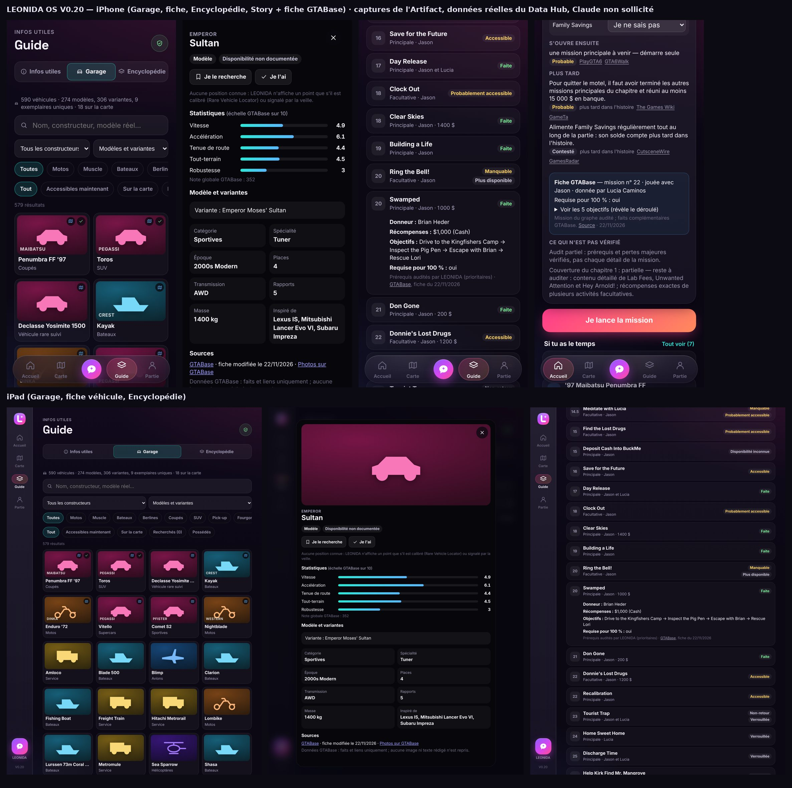

# LEONIDA OS V0.20 — Data Hub & Garage A+

Branche `experiment/claude-artifact`. Aucune modification de `main`, des services GPT ou Cloudflare.
Sauvegardes : schéma inchangé (révision 9) ; un seul champ facultatif ajouté (`wanted`, liste « Recherchés » du Garage),
absent des anciennes sauvegardes et initialisé à vide par la migration (testé).



## 1. Ce qui a été livré

| Livrable | État |
| --- | --- |
| Data Hub (format commun, acquisition, normalisation, dédoublonnage, liaison, changements, rapport) | Implémenté : `hub/` (Python), types `src/lib/hub/model.ts` |
| Adaptateur GTADB (dépôt GitHub public) | Implémenté, reproductible (`git fetch`) |
| Adaptateur GTABase (sitemap + HTML public, multi-catégories) | Implémenté : missions, étrangers et fous, activités, véhicules, armes, personnages, propriétés, animaux, radios, vues de carte, gangs, triches, articles |
| Story Intelligence / Mission Autopilot enrichis | Graphe : 33 nœuds audités → 173 nœuds (chapitres 1 à 5) |
| Knowledge / LEONIDA AI enrichis | Missions, véhicules, personnages, propriétés, armes et repères GTADB cités par la question joints au contexte avec leur source |
| Garage A+ | Intégré au Guide (Guide › Garage), 590 fiches, recherche, filtres, fiches détaillées, carte, « Recherché » / « Je l'ai » |
| Encyclopédie | Guide › Encyclopédie : missions par chapitre (anti-spoiler), armes, personnages, propriétés, activités, animaux, radio, repères |
| Commande d'actualisation | `python3 hub/refresh.py` (procédure : `hub/README.md`) |
| Tests | 18 tests Python du pipeline, 11 tests unitaires TS, 18 tests de bout en bout (iPhone, iPad, WebKit), suite complète relancée (§9) |

## 2. Sources : ce qui fonctionne, ce qui échoue

### GTADB — fonctionne
- Accès : `git clone --depth 1 --sparse` de `github.com/rolux/gtadb.org` (le README du dépôt demande d'utiliser `git pull`, pas le site).
- **Révision actuelle `d406fea` du 19/11/2026 = celle de notre copie** : aucun changement de données disponible à ce jour.
  La commande le vérifie à chaque exécution et régénère les repères bruts si la révision change.
- Ce que notre copie n'exploitait pas : 91 lieux connus **sans position** (désormais listés, jamais placés au hasard),
  la contrepartie réelle (adresse, coordonnées GPS réelles), les dates de mise à jour, et **2 487 photos en jeu**
  (`map/photos/6/L…,ig.jpg`).
- Photos en jeu : la licence du dépôt les déclare CC BY 4.0, mais ce sont des images du jeu (Rockstar). Conformément à la
  règle « pas de captures protégées », **elles ne sont ni intégrées ni publiées en V0.20** ; leur disponibilité est
  enregistrée par repère. Elles permettraient une vraie comparaison visuelle dans Vision : décision à prendre (§10).
- Tuiles : inchangées (même révision). Une reconstruction reste manuelle (`scripts/build_gtadb_assets.py`, clone complet).

### GTABase — fonctionne (1 page en échec)
- Sitemap officiel lisible ; 8 sous-sitemaps anglais **plafonnés à 8 000 URL** : 1 403 URL GTA 6 trouvées, dont deux schémas
  d'URL actifs (`/gta-6/vehicles/…` et `/vehicles/gta-6/…`).
- Complément par les **liens internes** des pages lues : +208 fiches absentes du sitemap (variantes de véhicules, missions).
- **1 610 pages lues, 1 échec** : `/gta-6/vehicles/speeder` (HTTP 404, lien mort côté GTABase), signalé dans le rapport.
- Aucune API supposée ; `/media/com_jamegafilter/en_gb/1.json` (403) non utilisé.
- Politesse : 0,6 s minimum entre deux requêtes, `robots.txt` respecté, cache local (pas de relecture d'une page inchangée).
- Droits : GTABase est « tous droits réservés » → seuls des **faits** (champs structurés, listes, liens) et l'URL sont repris.
  Ni texte rédigé (soluces, descriptions), ni image. Les vignettes du Garage sont générées (silhouette + couleur de catégorie),
  avec un lien « Photos sur GTABase ».

## 3. Entités importées (exécution du 24/11/2026)

| Source / catégorie | Enregistrements |
| --- | --- |
| GTADB · lieux | 3 754 (3 663 avec position, 91 sans) |
| GTABase · véhicules | 589 (274 modèles, 306 variantes, 9 exemplaires uniques) |
| GTABase · missions | 120 (principales et facultatives) |
| GTABase · étrangers et fous | 51 |
| GTABase · activités libres | 16 |
| GTABase · armes | 212 |
| GTABase · personnages | 71 |
| GTABase · propriétés | 22 |
| GTABase · animaux | 245 |
| GTABase · radios | 21 |
| GTABase · vues de la carte (collectibles, cascades…) | 29 |
| GTABase · gangs / événements / triches / guides | 4 / 1 / 3 / 1 |
| GTABase · articles (index seulement) | 189 |
| Liste des missions (ordre, chapitre, badges manquable / non-retour) | 134 entrées |

Dédoublonnage : 14 missions présentes à la fois dans « missions » et « strangers » fusionnées (provenances conservées).
Les deux vues de carte de même titre ne sont plus fusionnées (corrigé pendant le développement, testé).

## 4. Architecture

```
GTADB (git) ─┐                         ┌─ src/data/hub/missions.json  → graphe (Story, Autopilot), Encyclopédie
             ├─ hub/refresh.py ─ référentiel hub/records/*.json ─┼─ src/data/hub/meta.json      → fraîcheur, comptes
GTABase ─────┘  (cache, reprise,       └─ public/data/hub/{vehicles,catalog,places}.json → Garage, Encyclopédie, LEONIDA AI
 (sitemap +      dédoublonnage, liaison,
  liens)         changements, rapport)
```

- Format commun : identité, type, champs présents, relations, provenance (URL, date de modification, date de collecte,
  licence), confiance, couverture (champs présents / attendus manquants), contradictions.
- Un seul pipeline pour tous les modules : le Garage, la Story, Knowledge et l'Encyclopédie lisent les mêmes bundles.
- Rien n'est reconstruit : le Hub **relie** ses fiches au graphe audité, à l'inventaire Story, à Knowledge, au Rare Vehicle
  Locator et aux établissements (alias manuels justifiés dans `hub/aliases.json`).
- Repères GTADB bruts (`public/data/landmarks.json`, format historique) séparés de l'enrichissement (`places.json`).
- Hors partie : l'app ne contacte ni GTABase ni GTADB ; Exa reste utilisé pour les recherches ponctuelles.

## 5. Story Intelligence et Mission Autopilot

- **Graphe : 33 → 173 nœuds**. 140 missions ajoutées (chapitres 1 à 5), dont 55 avec des prérequis lus dans la phrase
  « How To Unlock » de GTABase (67 liens au total), 10 reliées à l'inventaire Story existant.
- **Le graphe audité n'est jamais remplacé** : les 31 missions déjà auditées reçoivent seulement des faits (n°, donneur,
  personnage joué, récompenses, objectifs, requise pour 100 %). Si GTABase cite d'autres préalables, la différence est
  affichée et non appliquée (aucune à ce jour après correction de l'analyseur).
- Une mission du Hub n'a qu'une source : jamais « accessible / Vérifié », au mieux « potentiellement accessible » ;
  « usually » dans la phrase → lien « déduit ». Sans phrase : « disponibilité inconnue ».
- Conséquences nouvelles : points de non-retour des chapitres 4 (Sunset) et 5 (Unfinished Business) signalés, ainsi que celui du
  chapitre 2 (Checking Out, déjà dans l'inventaire Story) ; fenêtre de perte de Bad Driver! au lancement de Power Play (la règle validée existante prime, pas de
  doublon) ; « s'ouvre ensuite » calculé pour les chapitres 2 à 5 (ex. Credit Check → Sinfrontera National Bank, Ride or Die).
- Autopilot : au chapitre 3 ou 4, la suite est proposée « à confirmer » à partir du graphe partiel ; au chapitre 2 (GTABase ne
  cite presque aucun prérequis), il le dit : « Graphe partiel pour le chapitre 2 (prérequis lus sur GTABase, une seule
  source) ». Lacune réelle : 85 missions sur 120 sans phrase de déblocage chez GTABase.
- Visible : simulation « Si je lance… » (bloc « Fiche GTABase », objectifs repliés car ils révèlent le déroulé), ligne de
  couverture (« N missions connues via GTABase »), Encyclopédie › Missions (statut calculé pour chaque mission).
- Anti-spoiler : le contexte de LEONIDA AI, le Guide et l'Encyclopédie ne citent que le chapitre atteint et les précédents
  (strict) ; en mode léger, les chapitres suivants sont réduits à un compte.

## 6. Knowledge, Vision et LEONIDA AI

- Toute mission, véhicule, personnage, propriété ou arme **cité par la question** est joint au contexte avec ses faits et
  son URL (« DATA HUB… une seule source chacune »). Une question qui n'en cite aucun n'ajoute rien.
- **Lieu inconnu de Knowledge** : les repères GTADB dont le nom apparaît dans la question — ou dans un panneau lu sur une
  capture (1re passe Vision) — sont joints (3 663 repères + 91 lieux sans position, jamais placés). Le joueur n'a plus à
  fournir lui-même le nom quand il est lisible ; sinon la recherche web sur besoin (V0.19) reste le recours.
- Propriétés GTABase reliées aux repères GTADB par nom identique : 4 (les autres restent non reliées plutôt que devinées).
- Vision V0.19 préservée (tous ses tests passent). **Aucune reconnaissance réelle n'a été testée avec le modèle réel** :
  tous les tests utilisent un Claude simulé.

## 7. Garage A+ (Guide › Garage)

- 590 fiches : les 589 véhicules GTABase + les véhicules rares suivis par LEONIDA absents du catalogue (jamais perdus).
- Recherche (nom, constructeur, modèle réel), filtres constructeur, catégorie (en français), type de fiche (modèle,
  variante, exemplaire unique, véhicule rare suivi), accessibles maintenant, sur la carte, recherchés, possédés.
- Fiche : statistiques (échelle GTABase sur 10), caractéristiques, prix / immatriculation / revente quand GTABase les donne,
  « comment l'obtenir », modèle de base et variantes cliquables, disponibilité selon la progression (Rare Vehicle Locator et
  veille ; sinon « non documentée »), « Je le recherche » / « Je l'ai » (sauvegardés), « Voir sur la carte », sources datées.
- Positions : **uniquement** celles du Rare Vehicle Locator (calibrées, non modifiées) ou de la veille — 18 véhicules.
  Le catalogue n'en invente aucune.
- Images : aucune photo GTABase (droits) ; vignettes générées, rendu propre sans image (testé).
- iPhone : 2 colonnes, 48 fiches puis « Afficher plus » ; iPad : 4 à 5 colonnes ; fiche en panneau plein écran / modal.
- Lacunes de données GTABase : prix connu pour 2 véhicules sur 589, statistiques manquantes pour 148, transmission pour 154.

## 8. Actualisation

`python3 hub/refresh.py` (en ligne) ou `--offline`. Détecte les changements (ajouts, suppressions, champs et relations
modifiés → `hub/history/changes.jsonl`), conserve l'historique des sources, évite les doublons, produit
`hub/reports/latest.md`. Exécution manuelle uniquement (l'automatisation périodique est prévue en P2). Le cache HTML
(158 Mo) n'est pas versionné ; le référentiel normalisé (`hub/records`, 4,5 Mo) l'est.

## 9. Tests

Tous les tests ci-dessous utilisent des **données réelles du Hub** et, pour LEONIDA AI, un **Claude simulé**.
Aucun test n'a été fait sur iPhone réel par le joueur.

| Suite | Résultat |
| --- | --- |
| Pipeline Python (`hub/tests`, fixtures synthétiques) : lecture des champs, variantes, liste ≠ mission, badges, phrases de déblocage, dédoublonnage, changements, erreurs (page absente, échec réseau, cache), GTADB | 18 / 18 |
| Unitaires TS `hub.unit.spec.ts` : graphe enrichi, graphe audité intact, une source ≠ Vérifié, conséquences, non-retour, Autopilot chapitre 3, anti-spoiler du contexte, Data Hub dans LEONIDA AI, Garage (liaison, filtres), migration de sauvegarde | 11 / 11 |
| Bout en bout `v020.spec.ts` × iPhone, iPad, WebKit : Garage (recherche, filtres, fiche, « Recherché » après rechargement, aucune image tierce, chargement < 4 s), Garage → Carte, catalogue indisponible, Encyclopédie (strict, léger, sources), Story | 18 / 18 |
| Suite complète (régressions Autopilot, Vision, carte, sauvegardes, iPhone / iPad / WebKit), une seule exécution sur le build standard | **502 réussis, 0 échec, 4 ignorés** (19,9 min) |

Deux tests existants ont été mis à jour pour un changement voulu : la version (V0.20) et la phrase de l'Autopilot au
chapitre 2 (« Graphe partiel… » au lieu de « pas encore de graphe »).

## 10. Limites et décisions à prendre

- **Photos en jeu GTADB** (2 487) : licence CC BY déclarée par GTADB, mais images du jeu. Non intégrées. Si tu valides leur
  usage (au moins comme références envoyées au modèle, sans les afficher), Vision pourrait comparer réellement une capture
  à des vues de référence.
- GTABase est une seule source : rien de ce qu'elle apporte n'est « Vérifié ». Le recoupement par d'autres sites reste à faire
  pour les chapitres 2 à 5 (la file d'enrichissement validé est en P2).
- Phrases de déblocage absentes pour 85 missions : leur disponibilité reste « inconnue ».
- Le sitemap est plafonné : la découverte par liens internes compense, sans garantie d'exhaustivité.
- Latence réelle sur iPhone non mesurée (mesure locale : Garage affiché en moins de 4 s, exigence du test).

## 11. Résultat de la suite complète et publication

- Premier passage complet : 496 réussis, 6 échecs = 2 tests × 3 appareils vérifiant d'anciens libellés (format de version
  `V0.1x`, phrase « pas encore de graphe » du chapitre 2). Tests mis à jour pour le comportement voulu, puis **nouveau passage
  complet : 502 réussis, 0 échec, 4 ignorés**. Pipeline Python : 18 / 18.
- Un passage intermédiaire lancé par erreur sur le build Artifact (veille figée) avait 2 échecs propres à ce mode
  (tests de la veille en direct et des signaux de démonstration) ; il n'est pas compté.
- Build Artifact contrôlé (tests V0.20 sur iPhone : 6 / 6), publié en patch : 9 fichiers, 2 anciens retirés,
  `data/radar.json` non republié, déclaration inchangée (`sample: { images: true }`, Exa via `mcp`).
  **Version Artifact `1795521584-ef58`** ; 412 fichiers servis, empreintes identiques au build, tuiles z3 présentes (30).
