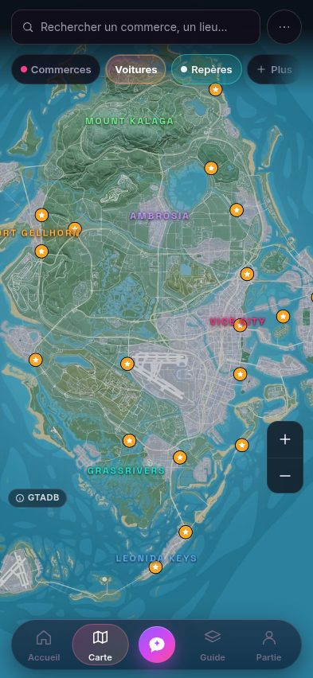
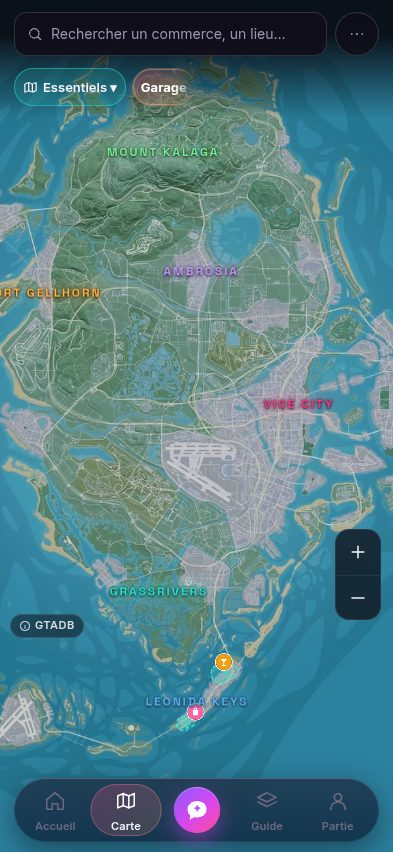
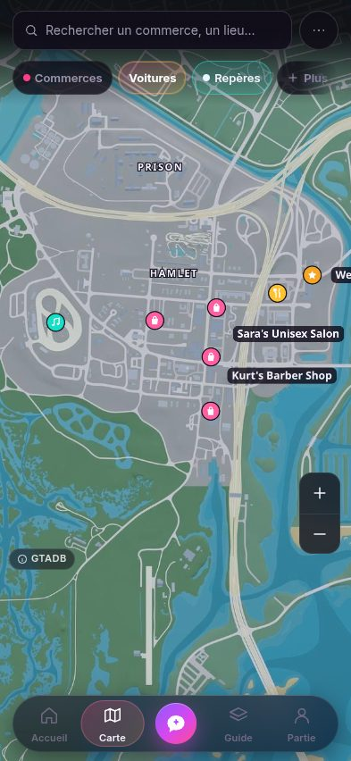
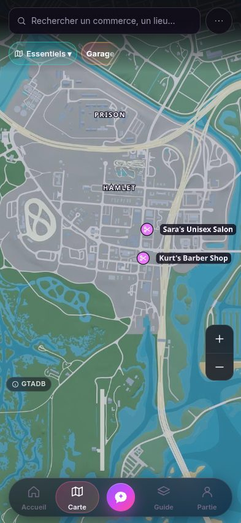
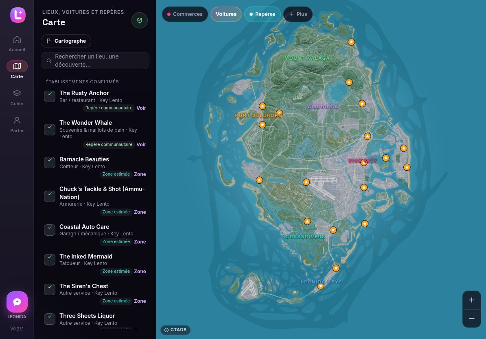
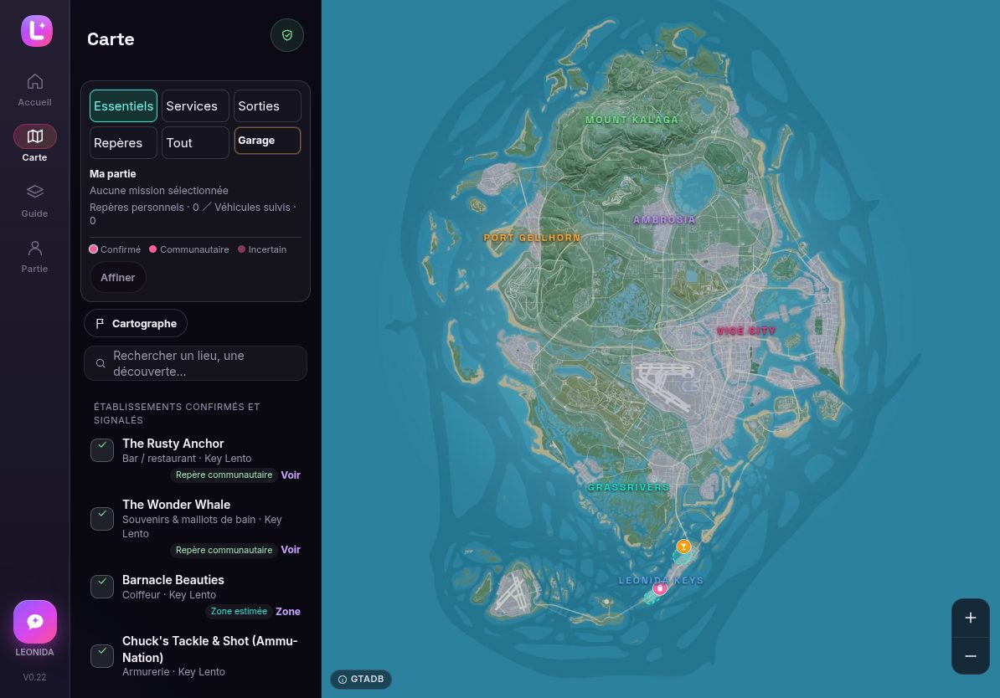
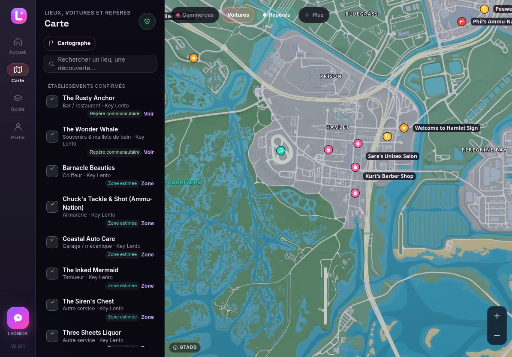
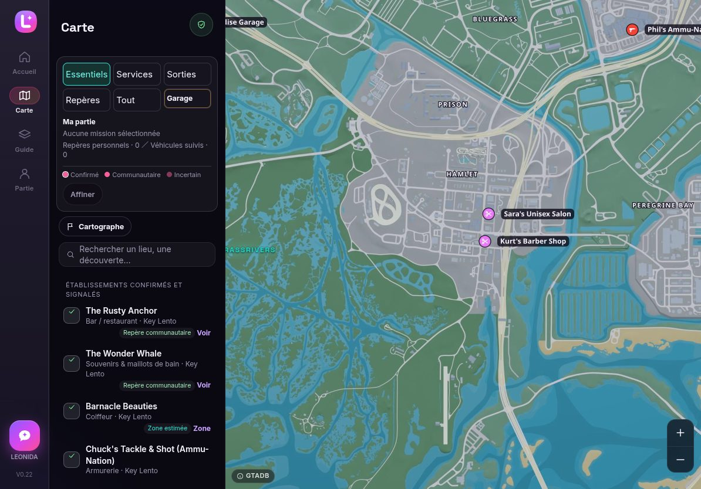

# V0.22 — Carte utile par défaut

Branche de revue `codex/map-v022`, issue [#21](https://github.com/teoselimo/leonida-os/issues/21), base `6eb8ecb`. Publication en attente.

## Couches et précision

| Couche | Contenu |
| --- | --- |
| Essentiels | Points d’établissement connus, zones restreintes sourcées, métiers utiles, planques, garages et stations. |
| Services | Commerces, armureries, vêtements, coiffure, tatouage, tuning, garages et stations. |
| Sorties | Restaurants, bars, loisirs et hôtels. |
| Repères | Monuments et transports communautaires. |
| Tout | Les 3 663 repères. Les points génériques apparaissent au zoom de rue (7), avec gestion native des collisions. |
| Garage | Véhicules, filtres, points calibrés avec leur incertitude et parcours RVL. |

Sur iPhone, toucher le nom de la couche ouvre le sélecteur. Sur iPad, les choix sont dans l’inspecteur. **Affiner** donne accès aux filtres détaillés. La recherche parcourt le référentiel complet et les établissements sourcés, même pour une boutique dont la position reste inconnue. Elle reconnaît aussi les métiers en français. Une recherche ou un renvoi du copilote peut sélectionner un POI en dehors de la couche active. Sa fiche indique la provenance, la précision et les informations GTADB disponibles.

L’anneau blanc indique un établissement confirmé par les sources. La couleur indique le métier ; une icône atténuée indique une incertitude de la carte communautaire. La confirmation de l’existence du commerce et la vérification en jeu de ses coordonnées sont deux informations distinctes.

**Ma partie** relit la mission sélectionnée, les positions du joueur, les véhicules recherchés visibles à son chapitre et le lieu demandé par LEONIDA. Le périmètre indicatif d’un district de mission est estimé à partir des repères du même district (au moins cinq ; rayon couvrant environ 85 % des distances au centre, avec marge). Il ne situe aucun personnage. Les zones restreintes d’établissements proviennent de `placementOf` et les positions du Garage du référentiel RVL. Une page de catégorie GTABase ne produit aucune géométrie.

## Rendu et persistance

MapLibre utilise les mêmes coordonnées, sources raster et 363 tuiles GTADB. La source des lieux reçoit les géométries de la couche active et, si nécessaire, le POI sélectionné. Les seuils de zoom, la collision des symboles et le regroupement d’un filtre détaillé restent natifs. Le déplacement de la caméra ne recalcule pas les géométries des lieux. Les pictogrammes et noms sont dessinés sur canvas à la demande. Les lieux génériques ne génèrent pas d’image de nom.

La couche choisie est une préférence locale (`leonida-os/map-layer/v1`). La caméra garde sa clé existante. Le démarrage relit sa valeur avant le redimensionnement initial de MapLibre. Le schéma de progression, le Data Engine et les sources de la carte sont identiques à la base.

## Mesures locales

Mesures sur les exports Artifact de `6eb8ecb` et de V0.22, avec le même flux RADAR du 27 novembre 2026 à 15:23:43 UTC, Chromium 156 et rendu logiciel SwiftShader. Les nombres visibles sont les symboles uniques renvoyés par MapLibre au cadrage demandé, après l'événement `idle`. Une collision peut donc réduire le total lorsque le zoom augmente ou que la carte se recentre.

| Couche V0.22 | Lieux dans la source GeoJSON | Zones | Symboles visibles à Hamlet — ensemble / quartier / rue |
| --- | ---: | ---: | ---: |
| Essentiels | 79 | 6 | 2 / 3 / 3 |
| Services | 214 | 6 | 1 / 6 / 14 |
| Sorties | 187 | 0 | 1 / 7 / 4 |
| Repères | 182 | 0 | 19 / 2 / 0 |
| Tout | 3 663 | 0 | 19 / 10 / 17 |
| Garage | 0 | 78 | zones et marqueurs RVL dédiés |

Avant V0.22, la source principale recevait 3 663 lieux dans tous les modes. En mode Essentiels, elle en reçoit 79, soit 97,8 % de géométries en moins. La recherche continue à utiliser les 3 663 objets en mémoire. Les cadrages iPhone donnent 18 / 7 / 16 symboles avant, puis 2 / 2 / 3 en Essentiels. Les cadrages iPad donnent 19 / 10 / 17 avant, puis 2 / 3 / 3.

L'instant d'instanciation de MapLibre depuis la navigation a été observé une fois à 2 111 → 1 580 ms sur l'iPhone émulé et 1 265 → 1 335 ms sur l'iPad émulé. L'état `loaded()` a été atteint à 4 820 → 3 357 ms et 3 496 → 3 265 ms. Sur un déplacement animé de 1,5 seconde dans Tout, l'intervalle médian entre événements de rendu a été 258 → 231 ms sur iPhone et 292 → 232 ms sur iPad. Ces essais uniques sous rendu logiciel sont des contrôles de non-régression, pas une mesure de gain sur appareil Apple.

Le package garde **472 fichiers publiables**. Sa taille passe de 62 626 884 à **62 632 318 octets** (+5 434), avec **363 tuiles / 51 981 760 octets** inchangés. La marge sous 64 Mio est de 4 476 546 octets. Aucun nouveau fichier de tuile, tileset ou pictogramme raster n'est embarqué.

## Validation

- TypeScript strict, build standard, build Artifact et les deux contrôles du manifeste v1 réussis sur un clone propre de `ceb9f34`.
- 253 tests unitaires réussis, dont les règles de couche et la recherche métier.
- 85 parcours ciblés réussis, 1 ignoré selon la configuration, en 14,4 minutes sur le build standard propre. Ils couvrent `v022`, `v015`, le Rare Vehicle Locator, le copilote, la recherche, les établissements et la carte existante sur iPhone Chromium, iPad Chromium et iPhone WebKit.
- 19 parcours ciblés réussis en 8 minutes sur le package Artifact propre. Ils couvrent les couches, la caméra, le pan, le pincement, la sélection hors couche, le mode cartographe, `placeFocus`, Garage / RVL, l'anti-spoiler et la sauvegarde inchangée.
- Le Data Engine, les données GTADB, les positions RVL et le schéma de sauvegarde ont un diff vide par rapport à `6eb8ecb`.

Les gestes WebKit sont synthétiques sous Linux. Le seuil des icônes et la taille du sélecteur restent à confirmer sur un iPhone et un iPad physiques. Une V0.22.1 pourra ajuster les seuils de zoom à partir de ce retour, sans modifier les sources ni les coordonnées.

## Comparaison visuelle

Même export local, même flux RADAR et mêmes cadrages pour les deux versions. Les vues de quartier montrent Hamlet, autour de Sara’s Unisex Salon, Kurt’s Barber Shop et Phil’s Ammu-Nation. Captures Chromium mobile émulé.

| Vue | Avant | Après |
| --- | --- | --- |
| iPhone · Leonida |  |  |
| iPhone · Hamlet |  |  |
| iPad · Leonida |  |  |
| iPad · Hamlet |  |  |
