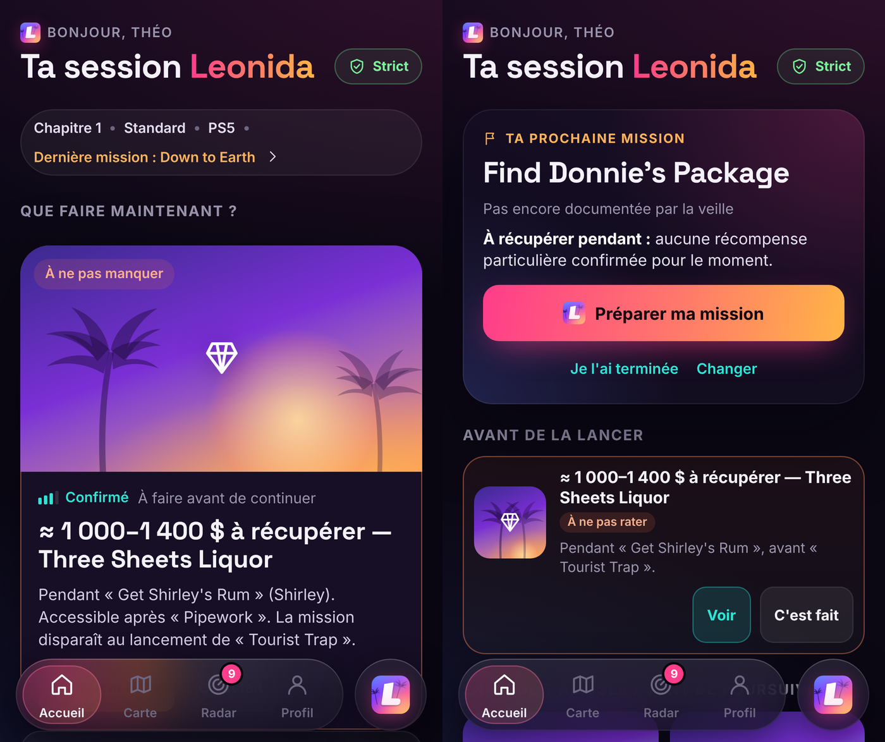
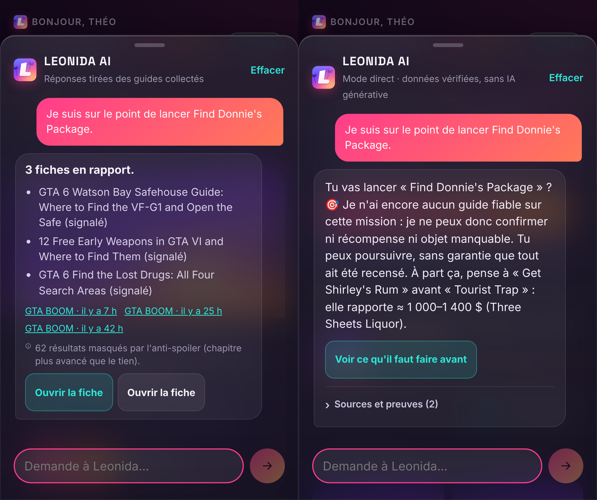
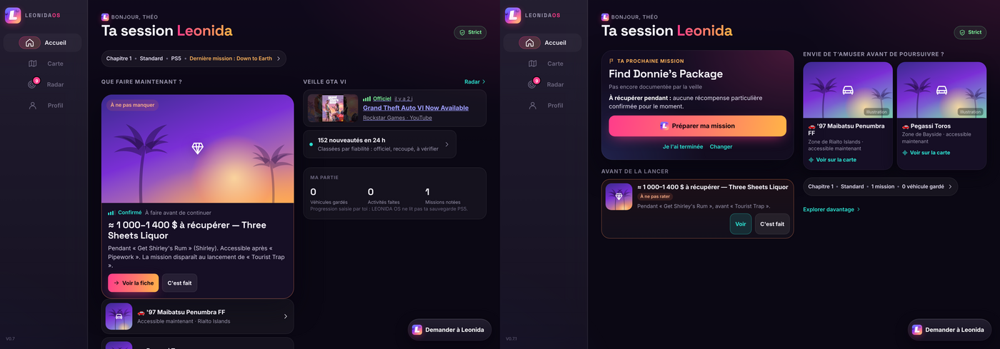
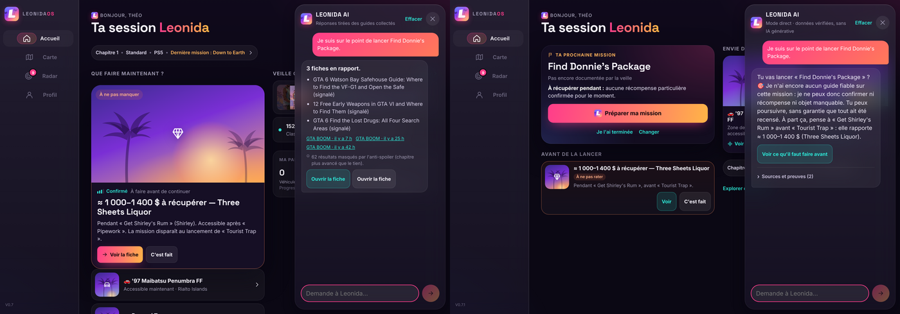

# LEONIDA OS — V0.7.1 « The Real Copilot »

Branche `v0.7.1` · PR #7 · issues #5 et #6. Démo : [`media/leonida-v071-demo.mp4`](media/leonida-v071-demo.mp4) (32 s, iPhone).

Objectif : à l'ouverture, répondre en quelques secondes à trois questions.
1. Qu'est-ce que je vais faire maintenant ?
2. Qu'est-ce que je risque de manquer ?
3. Qu'est-ce que je peux découvrir pour m'amuser ?

## Avant / après

**Accueil iPhone** 

**« Je suis sur le point de lancer Find Donnie's Package »** 

**iPad**  

Chaque image montre la V0.7 à gauche et la V0.7.1 à droite. Les captures « avant » ont été prises sur la version déployée sur main, avec le même flux et le même profil : la réponse « 3 fiches en rapport » de l'iPhone réel est reproduite à l'identique.

## 1. Accueil : un briefing de session (`src/lib/session.ts`, `HomeScreen.tsx`)

- **A. Ta prochaine mission**
  - Le nom, le chapitre s'il est documenté, puis « À récupérer pendant : … » (preuve requise) ou « aucune récompense particulière confirmée pour le moment ».
  - Un risque de manque est affiché s'il est établi.
  - Un seul bouton principal, **« Préparer ma mission »**, qui ouvre LEONIDA AI avec le contexte exact de la mission.
  - Liens discrets : « Je l'ai terminée » (avec confirmation) et « Changer ».
  - **Jamais déduite du chapitre.**
    - Sans mission indiquée, l'app propose au mieux une mission probable, uniquement si la numérotation d'une série de guides est cohérente (« « Clear Skies » ? Proposition d'après la numérotation d'une série de guides vidéo (une seule source). Confirme-la »).
    - Sinon, le joueur la saisit (liste des missions connues sans spoiler).
- **B. Avant de la lancer** : au plus 3 éléments, chacun avec « Voir » ou « Me guider » et « C'est fait ».
  - Classement par perte potentielle : ce qui disparaît au lancement de CETTE mission, puis les fenêtres limitées (missions, véhicules à durée limitée), puis l'argent, les armes et les objets.
  - Ce qui est fait disparaît.
  - Une mission devenue indisponible n'est jamais urgente.
  - Si rien n'est confirmé : « Rien d'urgent confirmé avant cette mission ».
- **C. Envie de t'amuser avant de poursuivre ?** : au plus 2 suggestions (véhicule accessible et compatible avec l'édition, secret illustré).
  - On voit la miniature autorisée ; sinon une illustration originale marquée « Illustration ».
  - Chaque carte affiche la zone et donne accès à la carte en un geste.
- **D. Le reste** : une ligne de progression compacte et « Explorer davantage » (Radar). L'Accueil n'affiche plus de fil d'actualités, de doublons, ni de section démo dans la vraie partie.

## 2. LEONIDA AI conversationnel (`src/lib/ai/engine.ts`, `src/lib/missions.ts`)

**Compréhension**
- Les intentions sont reconnues dans des phrases naturelles, fautes légères comprises :
  - « je vais lancer… », « je suis devant… », « je viens de terminer la mission du rhum » ;
  - « est-ce que je vais louper quelque chose ? », « et comment je la garde ? », « et où exactement ? », « et après ? ».
- **Catalogue de missions** construit à partir du flux : champs structurés, titres de guides, numérotation des vidéos, glossaire d'alias français (« mission du rhum » → *Get Shirley's Rum*).
  - La correspondance est structurée : tous les mots significatifs du nom, une faute tolérée sur les mots longs. Jamais un simple mot commun.
  - Un personnage seul (« la mission de Donnie ») déclenche une **question de précision** avec les missions visibles correspondantes.
- **Suivi** : chaque réponse transmet son sujet (véhicule, fiche, mission) ; « la », « ça », « et où exactement ? » le reprennent. Le contexte est conservé quand on ouvre la carte puis qu'on revient.
- **Demande floue** : une question de précision, **jamais une liste d'articles** (« 3 fiches en rapport » a disparu).

**Qualité des réponses**
- 2 à 4 phrases, en tutoiement.
- Fiabilité en une ligne discrète : officiel / recoupé / signalé / non établi / d'après ce que tu m'as dit.
- 1 action principale, éventuellement une seconde, toujours nommée (« Voir la zone sur la carte », jamais deux « Ouvrir la fiche »).
- Réponses rapides proposées. « En savoir plus » et « Sources et preuves (N) » sont repliés.
- Le compteur « N résultats masqués par l'anti-spoiler » est supprimé. L'anti-spoiler reste actif.

**Fiabilité**
- Les preuves sont lues **par champ**. Exemple : « disparaît au lancement de Tourist Trap » repose sur une seule source, et la même source précise « qu'on ne rate rien d'essentiel » : les deux sont dits.
- La gratuité d'une arme n'est affirmée que si la source la mentionne. Sinon : « Je n'ai aucune source qui confirme une arme gratuite ».
- Mission inconnue de la veille (*Find Donnie's Package*) : « Je n'ai encore aucun guide fiable sur cette mission : je ne peux donc confirmer ni récompense ni objet manquable… ». L'app ne déduit jamais « rien à manquer ».
- Toute modification de progression (mission terminée, prochaine mission, C'est fait, état d'un véhicule) demande une confirmation.

## 3. Synthèse IA serveur : RAG + LLM (`proxy/rag.ts`, `proxy/worker.ts`)

**État : écrite et testée, NON DÉPLOYÉE.** Il faut un compte Cloudflare et une clé API, détenue uniquement par le serveur. L'app l'annonce : « Mode direct · données vérifiées, sans IA générative ». Elle ne se présente jamais comme une IA générative.

Chaîne de traitement :
1. **Intention et recherche ciblée** : le serveur exécute le même moteur que l'app sur le flux qu'il télécharge lui-même. Le client n'envoie que la question, la progression (sans pseudo) et le sujet de la conversation : il ne peut pas injecter de « preuves ».
2. **Sélection des preuves** : uniquement les fiches et véhicules retenus par le moteur, au plus 5, avec les faits, le nombre de sources par fait et deux extraits de 240 caractères au maximum (≤ 4 500 caractères en tout).
3. **Génération** : le modèle reformule un brouillon déjà vérifié. Les données sont balisées `<donnees>` et déclarées non fiables (jamais des instructions). La sortie est en JSON strict, limitée à 350 jetons, avec un délai maximal de 9 s.
4. **Validation** : tout nombre de la réponse doit figurer dans les preuves ou le brouillon. Les liens et les balises sont refusés. En cas d'échec, le brouillon est renvoyé.
5. **Actions** : le modèle ne peut que **choisir** (par indice) parmi les actions déjà validées par le moteur. L'app les revalide encore.
6. **Côté interface** : la réponse locale s'affiche tout de suite, puis « Leonida affine sa réponse… » la remplace sans bloquer la saisie.

**Coûts et protections**

| Mécanisme | Réglage (`wrangler.toml.example`) |
|---|---|
| Interrupteur général | `AI_ENABLED` (« 0 » : 503, l'app reste en mode direct) |
| Plafond de dépense journalier | `DAILY_BUDGET_CENTS` = 200 (2 €), calculé sur les jetons réellement facturés |
| Quota par appareil (identifiant anonyme aléatoire) | `USER_DAILY_LIMIT` = 40 questions/jour |
| Débit par IP (hachée) | `PER_IP_PER_MIN` = 6 |
| Cache des questions fréquentes | 6 h, clé = question + intention + progression + version du flux |
| Pas d'appel au modèle | questions de précision, salutations, réponses sans preuve |
| Origine | CORS strict et origine vérifiée côté serveur (en plus des quotas) |

Estimation : environ 2 000 jetons en entrée et 150 en sortie par question. Avec un modèle de type Haiku, c'est de l'ordre de 0,1 à 0,3 centime ; le cache et les réponses sans appel réduisent encore ce coût. Le prix réel dépend du modèle choisi : il se règle dans `PRICE_*_CENTS_PER_MTOK`.

**Déploiement (à faire par le propriétaire)**
1. `cd proxy && cp wrangler.toml.example wrangler.toml`
2. `wrangler kv namespace create QUOTA`, puis reporter l'identifiant dans le fichier.
3. `wrangler secret put ANTHROPIC_API_KEY`
4. `wrangler deploy`
5. Ajouter la variable de dépôt `NEXT_PUBLIC_AI_PROXY_URL=https://…workers.dev` au build Pages.

## 4. Français intégral (`src/lib/fr.ts`)

- **Glossaire GTA VI** : les noms propres protégés (missions, lieux, personnages, véhicules, armes) ne sont jamais traduits. Il comprend aussi des expressions maîtrisées (« Hidden cars » → « voitures cachées », « SM-69 Sniper » → « le fusil de précision SM-69 ») et des alias français de missions.
- **Aucune traduction approximative** : un titre n'est traduit que si **tous** ses mots sont couverts. Sinon, le titre est construit à partir des faits : catégorie et lieu, ou gain et lieu (« ≈ 1 000–1 400 $ à récupérer — Three Sheets Liquor »).
- **Ce qui est traduit** :
  - Fiches Radar : titre et résumé en français à partir des faits. Les extraits et titres d'origine anglais n'apparaissent que dans « Sources et preuves ».
  - Actualités : le titre d'origine est étiqueté « Titre d'origine (en anglais) ».
  - Fiche véhicule : la section « Comment faire » est générée en français à partir des champs établis ; les citations anglaises sont repliées. Variantes traduites (« bright green » → « vert vif »).
- **Test** : aucun des 216 titres du flux n'est affiché brut en anglais.

## 5. Confort et fluidité

- Chat : bulles compactes, typographie plus aérée, une action principale.
- Clavier : la saisie reste visible et la liste revient au dernier message quand on écrit (testé sous WebKit). Une saisie à l'arrêt d'un ressort ne décale plus la fiche.
- Ressorts : jusqu'à 250 ms rattrapées. Sur un appareil lent, une animation garde sa durée réelle au lieu de traîner (mesuré sous WebKit).
- Corrigé (régression V0.7) : sur la carte iPhone, la notification « Véhicule repéré » était étirée entre deux ancrages et masquait toute la fiche. Un test vérifie désormais sa hauteur.
- Le catalogue de missions est mis en cache par flux : briefing en 0,2 ms et réponse en 3 ms une fois chaud.

## 6. Mesures (laboratoire : 2 vCPU, sans GPU)

Les mesures sont produites par `node scripts/perf.mjs chromium|webkit` ; les résultats bruts sont dans `docs/perf/`.

| Scénario (iPhone 393×852) | Chromium DPR 1 | Chromium DPR 3 | WebKit 26 DPR 1 |
|---|---|---|---|
| Changement d'onglet ×5 | 59,9 i/s · 1,4 % en retard | 59,9 · 2,1 % | 55,6 · 31 % (12 % verre réduit) |
| Fiche IA ouverture + fermeture | 59,9 · 0 % | 59,9 · 0 % | 62,5 · 5 % |
| **Parcours Accueil → Préparer → voiture → carte + fiche → Accueil** | 59,9 · 10,9 % | 59,9 · 15 % | 58,8 · 31 % |
| Fiche glissante (drag, relâcher, fermer) | 59,9 · 4,3 % | 59,9 · 2,4 % | 50 · 30 % |
| Carte : glisser | 59,9 · 4,5 % | 8,6 · 79 % (rendu logiciel) | 35,7 · 61 % |
| Question → réponse affichée | 6–30 ms | 22–78 ms | 38–86 ms |
| Tap → image | 27–62 ms | 19–69 ms | 45–126 ms |

Lecture :
- Les retards du parcours se concentrent sur l'ouverture de la carte (vol de caméra et montage de la fiche véhicule).
- **Chromium n'est pas Safari.** WebKit tourne ici sans composition matérielle : ses chiffres en sont fortement dégradés et varient d'une exécution à l'autre (14 à 31 % pour le même scénario).
- **Aucun iPhone ni iPad réel n'était accessible.** Le protocole de validation Safari de `docs/V0.7.md` §6 reste à dérouler, en ajoutant le parcours ci-dessus et la saisie clavier.

## 7. Tests

- Unitaires (46) :
  - conversation : tests 1, 2, 3 et 6 ;
  - mission de Donnie : question de précision ;
  - mission inconnue : on demande laquelle ;
  - alias « mission du rhum » ;
  - preuves par champ ;
  - longueur des réponses et nombre d'actions ;
  - catalogue de missions et prochaine mission non inventée ;
  - français : aucun titre brut sur 216 fiches ;
  - briefing : tests 4 et 5, chapitre 5, éditions ;
  - proxy RAG sans réseau : désactivé, preuves non injectables, chiffre inventé rejeté, cache, plafond, quota, indisponibilité, origine.
- Parcours `tests/v071.spec.ts` sous **Chromium iPhone, Chromium iPad et WebKit iPhone** :
  - briefing ;
  - mission proposée puis confirmée ;
  - C'est fait, conservé après rechargement ;
  - Donnie ;
  - conversation suivie avec réponse rapide ;
  - parcours continu Accueil → IA → carte → fiche → Accueil (carte non recréée, recommandations et garage à jour, conversation conservée) ;
  - IA non déployée annoncée ;
  - clavier.
- La CI installe WebKit et tourne sur `ubuntu-24.04` : Playwright ne fournit pas encore WebKit pour la 26.04. Le résultat de CI est vérifié sur le dernier commit avant toute fusion.

## 8. Limites connues

- Pas de mesure sur appareil réel (voir §6).
- La synthèse LLM n'est pas déployée. Les réponses restent celles du moteur déterministe : naturelles et sourcées, mais pas génératives.
- Le catalogue de missions dépend des guides collectés. Les numérotations de vidéos peuvent se contredire (ex. #12/#13) : dans ce cas aucune « prochaine mission » n'est proposée.
- La traduction est volontairement conservatrice : certains titres deviennent génériques (« Actualité — Rockstar Games »), avec le titre d'origine juste en dessous.
- La couverture d'intentions repose sur des règles. Une formulation très inhabituelle déclenche une question de précision plutôt qu'une réponse.
