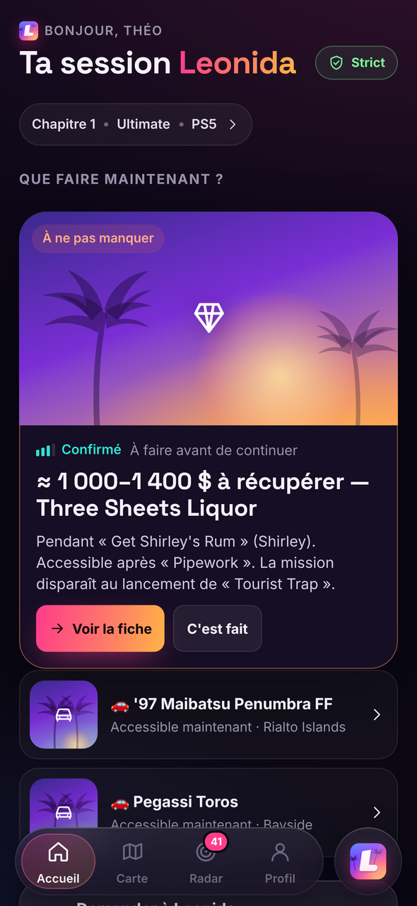

# LEONIDA OS — V0.7 « The Premium Experience »

Branche `v0.7` · PR #3 · issue #2. Démo : [`media/leonida-v07-demo.mp4`](media/leonida-v07-demo.mp4) (34 s, iPhone 393×852).

## 1. Corrections de la V0.6 (étape 1)

| Problème | Correction | Test |
|---|---|---|
| Test de centrage iPhone rouge (run 44893496972) | La fiche ne signale sa hauteur qu'une fois immobile (`data-settled`) ; la carte se recentre à ce moment-là, au-dessus de la fiche. L'assertion n'a pas été assouplie. | `e2e › recommandation → emplacement exact` (CI verte sur `cc83a6c`) |
| Planque du perroquet « urgente » au chapitre 5 | Une mission terminée, ou un chapitre plus avancé que celui de la fiche, retire l'urgence. Si la source dit qu'on ne rate rien, l'info reste, sans injonction. | `unit › V0.7 › mission terminée…`, `v07 › chapitre 5` |
| Pas de suivi de la dernière mission | Profil → « Dernière mission terminée » (missions connues par la veille, sans spoiler) ; `lastMission` + `missionsDone` | `v07`, `unit` |
| Chapitre inconnu compté comme 0 | Nouvel accès « À confirmer » distinct de « Accessible maintenant » ; filtre dédié sur la carte | `unit › chapitre inconnu…` |
| Précommande confondue avec l'édition | Réglage séparé (« J'y ai droit / Non / Je ne sais pas ») ; un bonus n'est jamais déduit de l'édition | `unit › précommande…` |
| Démo mélangée à la vraie partie | Démo désactivée par défaut (migration `rev 7`), réactivable dans Profil | `unit › migration` |
| Indices développeur visibles (`public/gameplay/`) | Remplacés par une vignette illustrée originale ; lien « Voir le guide illustré » | revue visuelle |
| Titres anglais bruts | Titres français générés à partir des faits structurés (gain, lieu), titre d'origine conservé en dessous | revue visuelle |

## 2. Système d'animation et fluidité

- **`src/lib/motion.ts`** : ressorts physiques à intégration semi-implicite (sous-pas de 4 ms), **interruptibles** (on reprend la position et la vitesse en cours), suivi de vitesse sur les 100 dernières ms et projection de l'atterrissage pour choisir la détente.
- **Fiches glissantes** (`Sheet.tsx`) : hauteur fixe, déplacement **uniquement par `transform`** (aucune mise en page par image). Trois détentes (mi-hauteur, plein écran, fermée). Un lancer franc vers le bas depuis le plein écran revient d'abord à mi-hauteur, sauf si le doigt a déjà dépassé la mi-hauteur. Le défilement interne prend le relais en plein écran. Gestion du clavier via `visualViewport`, Échap ferme la fiche, zones de sécurité respectées. La zone défilante s'arrête au bord visible une fois la fiche immobile, si bien que « Découverte terminée » et « Enregistrer » restent visibles.
- **Onglets** : glissement directionnel de 24 px + fondu, pastille du dock animée par ressort, retour haptique léger (`navigator.vibrate` quand il est disponible). MapLibre n'est jamais recréé : 1 instance mesurée, caméra et filtres conservés.
- **Liquid Glass** : `.glass` (flou + saturation) avec repli `@supports`, `prefers-reduced-transparency` et mode réduit. **Mode auto** : si 2 des 3 premières transitions perdent plus de 30 % de leurs images, le verre devient opaque (réglable dans Profil : Auto / Activés / Réduits). Pendant le geste et le ressort, une fiche au-dessus de la carte devient opaque : le flou sur une carte WebGL en mouvement est le cas le plus coûteux (mesuré : 8,8 % → 3,7 % d'images en retard).
- **Accessibilité** : cibles ≥ 44 px (testé), `prefers-reduced-motion` (ressorts et transitions remplacés par un changement immédiat), contrastes du thème sombre, portrait et paysage (iPad en panneau latéral).

## 3. Identité visuelle

Icône originale : carré arrondi, dégradé coucher de soleil (bleu → violet → rose → orange), silhouettes de palmiers, grand « L » blanc dessiné sur mesure (incliné, empattement court). Aucun élément du symbole PlayStation n'est repris : ni ses formes, ni ses contours, ni sa disposition.

- Concept A (maître) `brand/leonida-icon.svg` · B « Horizon » `leonida-icon-horizon.svg` · C « Repère » `leonida-icon-pin.svg`. Le nom de l'issue « Palm signal » correspond au maître.
- Fichiers dérivés : version maskable, monochromes blanc et noir, `favicon.svg`/`.ico`, icônes PWA et iOS (1024 → 120, 167, 152), `manifest.webmanifest`, logotype. Lisible à 60 px (vérifié sur rendu).
- Aucune police propriétaire redistribuée : le « L » est un tracé vectoriel.

## 4. LEONIDA AI

Accès discret et permanent sans 5ᵉ onglet : bouton rond à côté du dock (iPhone), fiche glissante plein écran ; panneau latéral à ressort sur iPad. La carte n'est jamais rechargée. Des amorces contextuelles s'affichent selon le chapitre, l'édition et ce qui reste à faire, et s'ouvrent aussi depuis l'accueil.

- **Recherche d'abord, sans clé** (`src/lib/ai/engine.ts`) : intentions (acheter, garder une voiture volée, Fast & Furious, arme gratuite, gagner de l'argent, manquables, Ultimate, secrets proches, recherche libre), réponses sur le flux réel uniquement. Le moteur respecte le chapitre, l'édition, l'éligibilité aux bonus de précommande, l'anti-spoiler, les missions terminées et les « C'est fait ».
- **Réponses** courtes, en français, avec niveau de fiabilité (officiel / recoupé / signalé), sources datées et cliquables, et une remarque d'honnêteté (« signalé par une seule origine », « 2 résultats masqués par l'anti-spoiler »).
- **Actions typées** validées contre le catalogue (identifiant existant, URL déjà présente dans les preuves) : centrer un véhicule, ouvrir la carte filtrée, **voir un lieu sur la carte** (repère gtadb du même nom, ou quartier → zone approximative ; jamais de coordonnées inventées), ouvrir ou filtrer le radar, ouvrir une source. Toute **modification de progression** (C'est fait, état d'un véhicule, mission terminée) demande une **confirmation**.
- **Sauvegarde PS5** : jamais lue ni prétendue lue. La progression vient de ce que le joueur indique.
- **Historique** local (`leonida-os/ai-history/v1`), effaçable en un geste.

### Sécurité et coûts
- **Aucune clé dans le frontend** : vérifié par un test qui parcourt le build (`v07 › build statique`). Aucun appel à un fournisseur d'IA depuis le navigateur (testé).
- **Proxy facultatif** `proxy/worker.ts` (Cloudflare Worker, **non déployé**). Il vérifie l'origine, limite la taille, plafonne les requêtes par minute (IP hachée) et impose un budget quotidien en KV. Il envoie un contexte minimal et anonyme. Les sources sont balisées `<donnees>` (jamais des instructions) et la sortie est en JSON strict, revalidée côté client. Il n'est appelé que si la recherche locale ne trouve rien et que `NEXT_PUBLIC_AI_PROXY_URL` (https) est défini au build.
- Coût : 0 € sans proxy. Avec le proxy, le budget journalier est fixé dans `wrangler.toml` ; une question coûte de l'ordre d'un millier de jetons.
- La saisie vocale et l'analyse de captures d'écran sont reportées à la V0.8.

## 5. Carte : comparaison avec l'affiche officielle

Le relevé est un relevé **toponymique uniquement** : environ 93 noms de régions, comtés, villes, quartiers, îles et lieux de l'affiche « Leonida Map Poster » (fournie par le propriétaire), lus manuellement avec l'aide de l'OCR. L'image n'est **ni copiée dans le dépôt ni publiée** : c'est une œuvre protégée de Rockstar Games, et sa réutilisation n'est pas couverte par la licence CC BY 4.0 de gtadb. La carte communautaire reste le fond de carte.

- `collector/data/poster-places.json` : nom, présence dans gtadb, position estimée par **ajustement affine** sur 33 repères communs (erreur RMS ≈ 240 unités de jeu). Ces positions sont **approximatives**, servent à l'identification et ne sont jamais présentées comme exactes.
- 48 noms existent dans gtadb. 45 n'y figurent pas encore comme quartier : Vespucci Island, Permit Keys, Casandova Island, Big Pine, Mount Kalaga National Park, VCIA, etc. Exemple utile : la Penumbra FF est décrite « Vespucci Island, among the Rialto Islands ». L'affiche confirme que Vespucci Island fait partie des Rialto Islands, et gtadb n'a que « Rialto Islands ».
- Seul écart notable sur un nom commun : l'étiquette « Vice-Dale County » (≈ 1 500 unités). C'est une étiquette de comté placée librement, pas une erreur.
- Prochaine étape (non faite) : alias de zones (Vespucci Island → zone dans Rialto Islands) pour la localisation des fiches, toujours affichés « Zone approximative ».

## 6. Mesures de performance (laboratoire)

`node scripts/perf.mjs chromium|webkit` (variables `DPR`, `GLASS`). Mesure le rythme des images par `requestAnimationFrame`, la latence tap → première image et les tâches longues. Résultats bruts : `docs/perf/*.json`. Machine de CI : **2 vCPU, sans GPU** (WebGL logiciel SwiftShader, composition logicielle WebKit).

| Scénario (iPhone 393×852) | Chromium DPR 1 | Chromium DPR 3 | WebKit 26 DPR 1 |
|---|---|---|---|
| Changement d'onglet ×5 | 59,9 i/s · 1,3 % en retard | 59,9 · 2,7 % | 55,6 · 23,7 % (14 % verre réduit) |
| Fiche IA ouverture + fermeture | 59,9 · 0 % | 59,9 · 0 % | 62,5 · 6,3 % |
| Fiche glissante (drag, relâcher, fermer) | 59,9 · 3,7 % | 59,9 · 5 % | 45,5 · 42,9 % (22 % verre réduit) |
| Carte : glisser 600 ms | 59,9 · 2 % | 10 · 75 % | 34,5 · 54,5 % |
| Tap → image | 27–61 ms | 28–56 ms | 36–129 ms |

Lecture :
- Toutes les animations de l'interface tiennent 60 i/s sous Chromium, même en DPR 3.
- La carte à DPR 3 et WebKit sont limités par le **rendu logiciel** de la machine (à DPR 1, la même carte tient 60 i/s). Sur iPhone et iPad, WebGL et la composition passent par le GPU.
- Sous WebKit logiciel, le coût du flou est net (de 14 % à 24 % d'images en retard). C'est la raison du mode verre **auto** et du verre opaque pendant les gestes.
- **Ces chiffres ne remplacent pas une mesure sur appareil.** Aucun iPhone ou iPad physique n'était accessible depuis cet environnement.

### Validation terrain à faire (Safari iPhone / iPad)
1. Safari → Réglages → Avancé → Inspecteur web ; Mac : Développement → [appareil] → Chronologies (Images, JavaScript).
2. Enregistrer : 5 changements d'onglet, glisser la carte 3 s, ouvrir, glisser et fermer une fiche véhicule, ouvrir LEONIDA AI et lancer une action.
3. Objectif : moins de 5 % d'images au-delà de 16,7 ms (ProMotion : 8,3 ms), aucun « long task » > 50 ms pendant un geste. Comparer Profil → Effets de verre Activés / Réduits.
4. Vérifier : la fiche suit le doigt, le lancer projette, le défilement prend le relais en plein écran, le clavier ne masque pas la saisie, le retour haptique est absent sur iOS (pas de `vibrate`).

## 7. Tests

- Unitaires : 26, dont 10 V0.7 (expiration de mission, accès à confirmer, précommande, réponses IA sur le flux de production figé `tests/fixtures/radar-prod.json`, validation des actions, injection).
- Parcours iPhone et iPad (Playwright) : V0.4 → V0.6 mis à jour, plus `tests/v07.spec.ts` qui couvre les critères de l'issue #2 :
  - arme gratuite sourcée avec action carte ;
  - Fast & Furious → zone + fiche + conseil pour la garder, sans recréer la carte ni perdre les filtres ;
  - chapitre 5 sans injonction ;
  - confirmation avant toute modification ;
  - historique effaçable, aucun appel IA externe, aucun secret dans le build ;
  - pas de chevauchement dock / bouton IA.
- Local : **96 tests passés, 0 échec, 2 ignorés par conception** (Chromium : geste propre à l’iPhone, contrôle du build lancé une seule fois) ; collecteur : 26/26. La conclusion de la CI est vérifiée sur le **dernier commit** de la PR avant toute annonce.

## 8. Limites connues
- Pas de mesure sur iPhone ou iPad réel (voir §6).
- La correspondance « lieu cité → repère gtadb » se fait par nom exact. Un nom identique à deux endroits renverrait vers le seul repère gtadb (ex. Phil's Ammu-Nation, rattaché à « Leonida » dans gtadb et à « Vice City » par la source). La carte l'indique comme repère communautaire.
- Le proxy IA n'est pas déployé : la synthèse générative est désactivée, la recherche locale répond seule.
- Les View Transitions (« cartes qui s'agrandissent ») ne sont pas utilisées : support Safari partiel, risque de saccade sur la carte.
